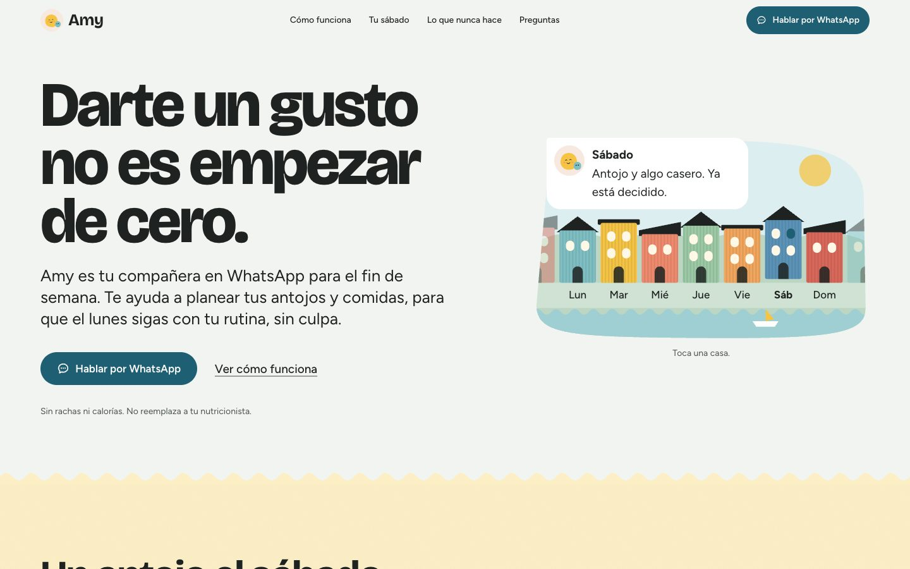
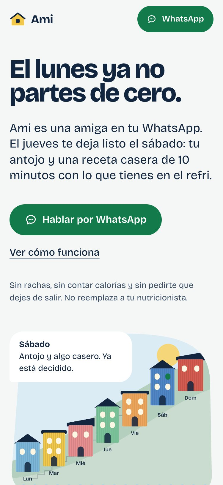
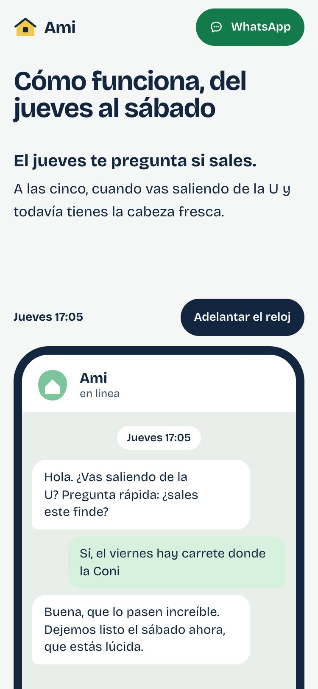
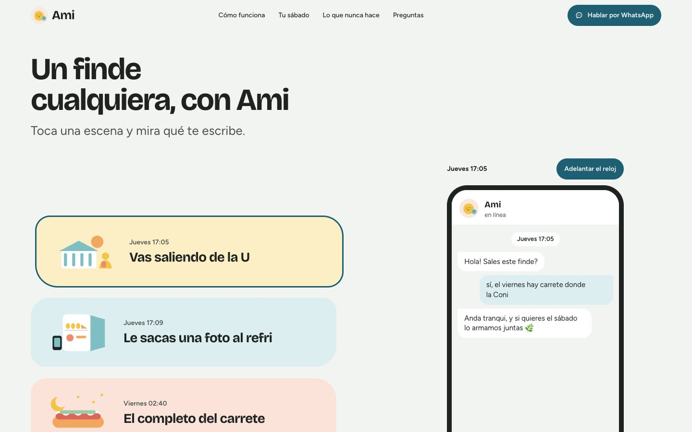

# Landing del agente de WhatsApp

La puerta de entrada al agente del caso Antonia: presenta qué hace y lleva a activarlo en WhatsApp. Es una sola página en Vite, React 19, TypeScript y Tailwind v4, prerenderizada a HTML estático.

En línea: https://hola-amy-hackathon.vercel.app (proyecto `hola-amy` del equipo de Vercel `amy-team-hackathon`; despliega solo cuando cambia esta carpeta). El proyecto `ami-landing` de la cuenta de Benja (hola-ami.vercel.app) quedó con los deploys automáticos apagados para ahorrar cupo.



| Móvil | Escenas en móvil | Escenas en escritorio |
|---|---|---|
|  |  |  |

## Lo que hay que cambiar antes de presentar

Todo está en [`src/config.ts`](src/config.ts):

- `NOMBRE`: el nombre del agente, «Amy» (decidido el 2026-10-23). También aparece en `index.html`, en el título y en las etiquetas OG.
- `WHATSAPP_NUMERO`: el número de Amy, hoy el del sandbox de WhatsApp de Kapso (`56920403095`). Solo responde a celulares activados en ese sandbox. Todos los botones «Hablar por WhatsApp» usan `WHATSAPP_URL`.
- `WHATSAPP_TEXTO`: el mensaje que queda escrito al abrir el chat («Hola Amy»).

Las conversaciones, los locales y los precios de ejemplo están en [`src/lib/conversacion.ts`](src/lib/conversacion.ts). Son inventados y la página los marca como ejemplo.

## Correr

```bash
npm install
npm run dev        # desarrollo
npm run build      # tsc + vite + prerender (dist/)
npm run preview    # sirve dist/
npm run lint       # oxlint
npm run capturas -- http://localhost:4173   # og.png, ícono y docs/*.jpg (con preview corriendo)
```

## Desplegar en Vercel

Ya está creado: el proyecto `ami-landing` en la cuenta personal, enlazado al repo con `landing` como **Root Directory** y el dominio `hola-ami.vercel.app` (`ami.vercel.app` lo tiene otro proyecto). `vercel.json` define el framework (Vite), el build y el directorio de salida. Cada push a `main` publica.

## Decisiones

- **Concepto «Borde costero».** La semana es una fila de siete casas de Valparaíso frente al mar, todas a la misma altura, y a los lados asoman casas sin nombre porque la semana sigue de largo: el domingo pasa al lunes sin salto. Antes era un cerro con las casas subiendo en diagonal («Cerro de calamina»), pero se leía como una montaña que hay que escalar, y del domingo, arriba, se «caía» al lunes, abajo: justo el «parto de cero» que se quiere evitar. Además chocaba con no mostrar progreso. Los bordes ondulados entre secciones son el perfil de la calamina.
- **La paleta de Amy, solo en claro** (la misma de los mockups): neblina `#F2F4F1` de fondo, tinta `#1E2321`, amarillo ascensor, celeste cerro y rubor como campos, y el azul puerto `#1F5F73` solo en lo que se toca (hablar por WhatsApp, elegir, avanzar).
- **Letra:** Bricolage Grotesque para el nombre y los títulos, y Figtree para el texto, como en los mockups.
- **Poco texto, escenas cotidianas:** el corazón de la página son seis escenas de un finde (saliendo de la U, la foto del refri, el completo del carrete, la caña, el sushi con las amigas, la culpa del domingo), cada una con su dibujo. Al tocarla, el chat muestra qué le escribe Amy en ese momento.
- **Movimiento que responde a la persona.** El chat avanza con «Adelantar el reloj» o con el scroll (en escritorio el teléfono queda fijo y los pasos pasan al lado). Las casas responden al toque. No hay animaciones ambientales continuas, para que ande fluido en equipos modestos. La entrada del hero está en CSS puro. Lenis se carga aparte y solo con movimiento.
- **Sin movimiento:** `prefers-reduced-motion` o `?reduced=1` apagan todo, y el contenido se ve igual.
- **El revelado al hacer scroll solo desplaza, nunca anima la opacidad**, para que Lighthouse no lo lea como falta de contraste.
- **Sin fotos de banco:** el chat, el refri y el cerro están dibujados en HTML y SVG.
- **Reglas del caso:** no hay calorías, números nutricionales, peso ni nada del cuerpo. La derivación es visible: su nutricionista, Salud Responde 600 360 7777, \*4141 y SAMU 131.

## Verificación (2026-10-23)

- `npm run build` y `npm run lint` sin errores.
- AccessLint (WCAG 2.2): 0 violaciones.
- Lighthouse en móvil, sobre `vite preview`: rendimiento 98, accesibilidad 100, buenas prácticas 100 y SEO 100. CLS 0, TBT 0 ms.
- Revisada a 375 px y 1440 px.
