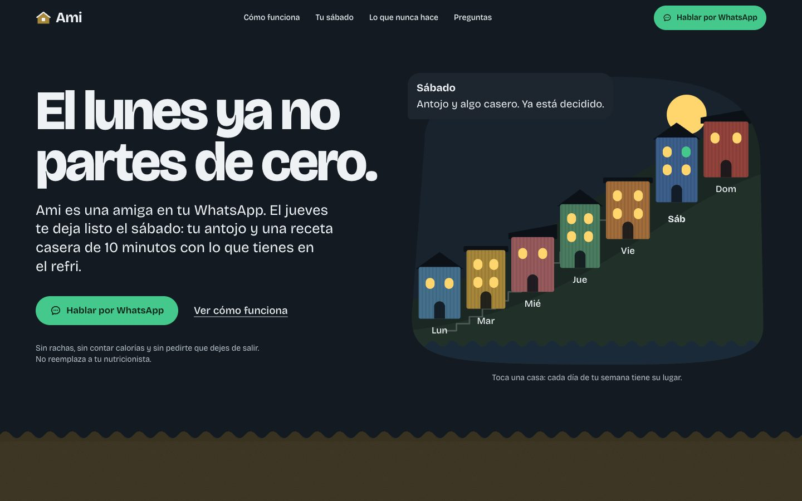

# Landing del agente de WhatsApp

La puerta de entrada al agente del caso Antonia: presenta qué hace y lleva a activarlo en WhatsApp. Es una sola página en Vite, React 19, TypeScript y Tailwind v4, prerenderizada a HTML estático.


| Móvil | Cómo funciona en móvil | Modo oscuro |
|---|---|---|
|  |  |  |

## Lo que hay que cambiar antes de presentar

Todo está en [`src/config.ts`](src/config.ts):

- `NOMBRE`: el nombre del agente, «Ami» (decidido el 2026-10-23). También aparece en `index.html`, en el título y en las etiquetas OG.
- `WHATSAPP_NUMERO`: el número del agente. Por ahora es `56900000000`, un marcador de posición. Todos los botones «Hablar por WhatsApp» usan `WHATSAPP_URL`.

Las conversaciones, los locales y los precios de ejemplo están en [`src/lib/conversacion.ts`](src/lib/conversacion.ts). Son inventados y la página los marca como ejemplo.

## Correr

```bash
npm install
npm run dev        # desarrollo
npm run build      # tsc + vite + prerender (dist/)
npm run preview    # sirve dist/
npm run lint       # oxlint
npm run capturas -- http://localhost:4173   # og.png, ícono y docs/*.jpg (con preview corriendo)
```

## Desplegar en Vercel

`vercel.json` ya define el framework (Vite), el build y el directorio de salida. Al importar el repo en Vercel, usa `landing` como **Root Directory** (Settings → General). Después de desplegar, conviene pasar `og:image` a una URL absoluta con el dominio final.

## Decisiones

- **Concepto «Cerro de calamina».** La semana es un cerro de Valparaíso con siete casas que siempre suben. El viernes y el sábado son casas como las demás, no un hoyo, y el cerro nunca baja: el lunes se sigue, no se parte de cero. Es una imagen, no un marcador de progreso (acordamos no medir progreso acumulado). Los bordes ondulados entre secciones son el perfil de la calamina.
- **Un solo verde para lo que se toca** (hablar por WhatsApp, elegir, avanzar). Los colores de las casas son campos de fondo, no acentos. En modo oscuro se ve el puerto de noche con las ventanas encendidas.
- **Una sola familia tipográfica:** Bricolage Grotesque variable, con eje óptico. Es cálida y algo irregular, con tono de amiga y no de app de salud.
- **Movimiento que responde a la persona.** El chat avanza con «Adelantar el reloj» o con el scroll (en escritorio el teléfono queda fijo y los pasos pasan al lado). Las casas responden al toque. No hay animaciones ambientales continuas, para que ande fluido en equipos modestos. La entrada del hero está en CSS puro. Lenis se carga aparte y solo con movimiento.
- **Sin movimiento:** `prefers-reduced-motion` o `?reduced=1` apagan todo, y el contenido se ve igual.
- **El revelado al hacer scroll solo desplaza, nunca anima la opacidad**, para que Lighthouse no lo lea como falta de contraste.
- **Sin fotos de banco:** el chat, el refri y el cerro están dibujados en HTML y SVG.
- **Reglas del caso:** no hay calorías, números nutricionales, peso ni nada del cuerpo. La derivación es visible: su nutricionista, Salud Responde 600 360 7777, \*4141 y SAMU 131.

## Verificación (2026-10-23)

- `npm run build` y `npm run lint` sin errores.
- AccessLint (WCAG 2.2): 0 violaciones.
- Lighthouse en móvil, sobre `vite preview`: rendimiento 98, accesibilidad 100, buenas prácticas 100 y SEO 100. CLS 0, TBT 0 ms.
- Revisada a 375 px, 768 px y 1440 px, en claro y en oscuro.
